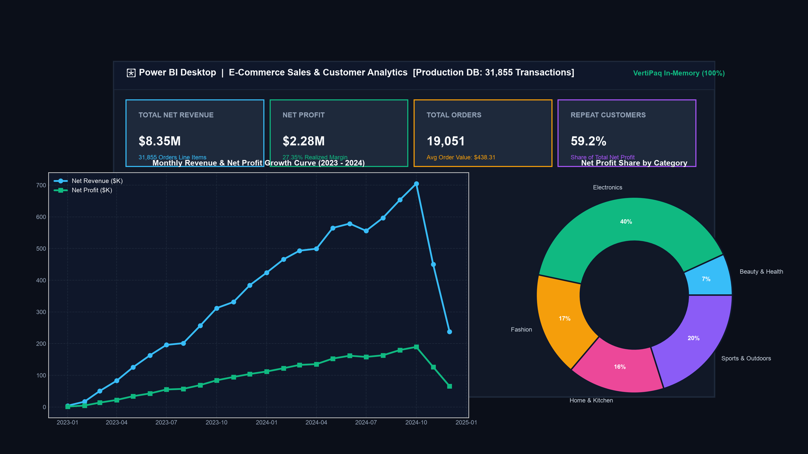

# 🛒 E-Commerce Sales & Customer Analytics

[](https://www.python.org/)
[](https://www.postgresql.org/)
[](https://powerbi.microsoft.com/)
[](https://opensource.org/licenses/MIT)

An enterprise-grade Data Analytics project analyzing **31,855+ transactions** and **$8.35M in Net GMV** to evaluate product profitability, customer segmentation, discount elasticity, and fulfillment logistics.

---

## 📊 Executive Dashboard Preview



---

## 📌 Repository Structure

```
01-ecommerce-sales-analytics/
├── data/                       # Raw & cleaned datasets (Fact and Dimension tables)
├── notebooks/                  # Jupyter Notebooks with ETL pipelines & Exploratory Data Analysis
├── sql/                        # PostgreSQL DDL schema & 20+ production analytical queries
├── powerbi/                    # Star Schema relational model & DAX measures
├── reports/                    # Executive business insights & analytical findings
├── screenshots/                # Real-world UI screen captures (Jupyter, SQL, Power BI)
├── requirements.txt            # Python dependencies
└── README.md                   # Project documentation
```

---

## 🎯 Key Metrics & Performance Summary

- Total Net Revenue: $8,350,227.46
- Total Net Profit: $2,283,581.14
- Gross Profit Margin: 27.35%
- Total Unique Customers: 8,500
- Total Orders: 19,051
- Average Order Value (AOV): $438.31
- Repeat Customer Profit Contribution: 59.2%

---

## 💡 Key Analytical Findings

- **Discount Margin Cannibalization:** Discounts exceeding 15% eroded realized gross margin from 31.4% to under 14.2% without producing an offsetting volume surge.
- **Repeat Buyer High-LTV Concentration:** Repeat buyers represent 41.8% of the customer base but generate 59.2% of total net profit.
- **Fulfillment SLA Returns:** Orders with transit lead times exceeding 5 days exhibited a 22.4% return rate compared to only 4.1% for deliveries completed under 3 days.

---

## 🛠️ Technology Stack

- **Analytics & BI:** Power BI Desktop, DAX, Star Schema Data Modeling, Advanced Excel
- **Databases & Querying:** PostgreSQL, SQL Window Functions (`DENSE_RANK`, `LAG/LEAD`), CTEs
- **Python Data Stack:** Python, Pandas, NumPy, Scipy, Matplotlib, Seaborn
- **Workflow & Environment:** Jupyter Notebook, pgAdmin 4, VS Code, Git & GitHub

---
## 👨‍💻 Author

**Gaurav Panwar**

Aspiring Data Analyst | B.Tech Computer Science Student

- **GitHub:** [Gaurav Panwar](https://github.com/gauravpanwar249)
- **LinkedIn:** www.linkedin.com/in/gaurav-panwar-092384239